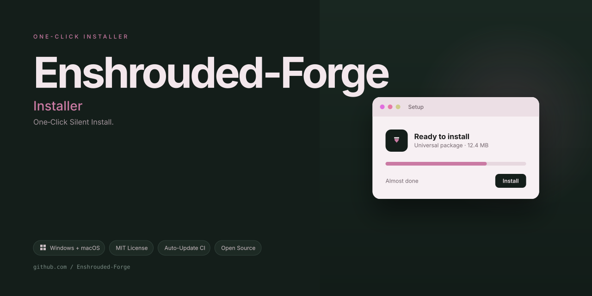

# Enshrouded-Forge: Companion Trainer 2026 Gameplay Enhancer — Windows 10/11

   

---

Enshrouded-Forge is the 2026 companion trainer built for players who want full command of their Enshrouded experience without compromise. It delivers a focused gameplay enhancement layer that puts trainers, healing controls, and a clean in-game menu exactly where you need them. Every feature is engineered for responsiveness, so your inputs land instantly and your session stays smooth. No bloat, no guesswork — just a sharper, more capable way to play.

## Features

- **Real-Time Stat Control** — Health, stamina, and mana sliders that update live. No menus to fight, no reloading required. You tune the numbers, the game follows.

- **Unlimited Resources** — Crafting materials and building blocks stay topped up on demand. Toggle it for a single build session or leave it running — your call, your world.

- **Free Flight & No Clip** — Move through the shroud on your own terms. Vertical flight, terrain pass-through, and instant repositioning make mapping and base scouting painless.

- **Item Spawner with Catalog** — Pull any item from a searchable, filterable in-game catalog. Spawn stacks directly into your inventory or drop them at your feet. No external lookup needed.

- **XP & Skill Multipliers** — Scale experience gain and skill point flow to match your pace. Fast-track a build idea or slow things down for a paced run — the multiplier is yours to set.

- **Fast Travel Override** — Unlock and use any waypoint without the usual progression gate. Cross the map in seconds and keep your session focused on what you actually want to do.

- **One-Hit & Damage Tuning** — Control incoming and outgoing damage independently. Go invulnerable for a base-tour, or crank your output for a shroud-clearing sweep.

- **Persistent Profiles** — Save your active toggle set as a named profile and load it in one click. Different setups for building, exploration, and combat — swap without reconfiguring a thing.

- **Hotkey-Driven Toggle Panel** — A compact overlay puts every cheat one keypress away. Bind what you use, hide what you don't. The panel stays out of the frame when you're not touching it.

- **Session Journal** — Every toggle change is logged with a timestamp. If something goes sideways, you can see exactly what was on and when — no guesswork.

- **Version-Matched Offsets** — Signatures are rebuilt against each supported game patch. When the game updates, the trainer updates. Stale builds are flagged, not silently broken.

- **Portable Configuration** — Settings live in a local file next to the trainer. Copy the folder, keep your setup. No cloud, no account, no telemetry.

## How It Works

Enshrouded-Forge runs external to the game and hooks into the live process at the memory and input layer. There is no injection into game files, no patch to the executable, and nothing written to your install directory — the companion reads and writes only in volatile memory during an active session, which is why it works cleanly across Enshrouded updates.

**Session attach.** On launch, the trainer scans for the running Enshrouded process, resolves the current build's signature set, and binds its feature modules to the matching offsets. Signature-based resolution means the tool adapts to patches rather than breaking on them — if the game updates, the trainer re-resolves instead of forcing you to wait for a rebuild.

**Feature toggles.** Every feature in the menu is an independent switch bound to its own hook. God mode intercepts incoming damage at the damage-application boundary. Resource features pin inventory counters to their current values instead of flooding them, so quest flags and crafting logic still read sane numbers. Movement features modify the player transform after the physics step, which keeps collision and terrain streaming honest — no falling through the world, no desync with the shroud.

**Overlay and input.** The overlay renders as a separate topmost window, not a render-hook inside the game's frame. That keeps it invisible to the game's own UI system and lets you toggle the whole thing with a single hotkey, including hotkeys you rebind at runtime. When the overlay is closed, the input listener detaches entirely.

**Session state.** Settings, hotkeys, and per-feature toggles persist between sessions in a local config. Nothing leaves your machine, there is no remote call in the hot path, and the trainer makes zero network requests during gameplay. Close the game and every mutation evaporates with the process — your save files are untouched unless you explicitly toggle a save-affecting feature and let the game commit it.

**Failure behavior.** If a signature fails to resolve on a new build, the affected module disables itself and reports which feature is unavailable rather than guessing offsets. Partial attachment is safe by design: the rest of the menu keeps working, and nothing writes to memory it hasn't verified.

## Supported Games

Enshrouded-Forge is built for **Enshrouded** — one game, one target, zero compromises. The trainer hooks directly into the current build's memory structures and keeps pace with official patches, so you're not left waiting weeks for a broken offsets update to drop while your friends are already back in the shroud.

The 2026 build is validated against the live retail client and the current seasonal content. Whether you're running a solo survival file, a co-op world, or a long-running base build, Forge reads and writes to the same game state the client does — no phantom toggles, no desyncs, no "it worked yesterday" energy.

### ✅ Fully Supported

- **Enshrouded (Retail Steam build)** — Full feature surface: godmode, stamina and mana management, item and resource handling, skill point adjustment, world state tweaks, and movement modifiers.
- **Co-op sessions** — Client-side features operate in multiplayer worlds, with server-authoritative toggles clearly marked in the menu so you know what sticks and what doesn't.
- **Current patch cycle** — Offsets are maintained against the latest stable branch. When a hotfix lands, Forge ships a rebuilt binary rather than a patched-after-the-fact workaround.

### ⚠️ Partial Support

- **Dedicated servers** — Only features flagged as client-side are guaranteed. Anything touching world state depends on the host's config and anti-tamper posture; treat those toggles as best-effort.
- **Experimental / beta branches** — Forge can attach, but offsets may drift mid-branch. If a beta patch breaks a feature, it's fixed when the branch goes stable, not before.

### 🚫 Not Supported

- **Consoles** — No plans, no ports, no "maybe someday." Memory-level tooling lives on PC.
- **modified or modified clients** — Different binary, different offsets, no support. You're on your own.
- **Unreleased or leaked builds** — Forge targets retail. Private builds aren't tested, and reports from them get closed on sight.

One game. Fully supported. That's the whole pitch.

## 📸 Screenshot

## Configuration

Enshrouded-Forge ships with sane defaults out of the box — launch it, point it at your Enshrouded session, and start tuning. Everything below is for when you want to go deeper. The config surface is split into three layers: the runtime config file, the in-session panel, and per-profile overrides. You never have to touch the file if the panel does the job.

**Runtime config file.** One flat config file sits in the tracker's working directory. It's plain text, human-readable, and hot-reloaded the moment you save — no restart, no ceremony. The engine validates every key on load and falls back to the shipped default for anything malformed, so a bad edit won't brick your setup. Comments are supported; keep them, they're your future self's friend.

**In-session panel.** The panel is the primary control surface. Every toggle and slider maps 1:1 to a config key, and every change is reflected in the file immediately. If you'd rather live entirely in the panel, you can — the file is a mirror, not a gatekeeper. Key bindings for summoning and dismissing the panel are remappable and stored alongside the rest of your preferences.

**Per-profile overrides.** Profiles are the recommended way to keep different playstyles separate. Each profile carries its own override block, which is layered on top of the global config at load time. Layer order is fixed: shipped defaults, then global config, then profile overrides. The panel shows you which layer won, so you're never guessing why a setting looks the way it does.

**Tuning notes that actually matter.**

- **Feature toggles are per-feature, not per-category.** Flip exactly what you want on and leave the rest at defaults. Nothing cascades.
- **Numeric ranges are clamped on load.** Out-of-range values snap to the nearest valid bound and log a warning — you'll see it in the console output, not in a popup.
- **Bind the panel to something ergonomic.** Default bindings exist, but remap if they collide with your muscle memory. It's a five-second change.
- **Profile switching is instant.** No reload, no session restart. Overrides apply on the next state tick.
- **Reset is always one action away.** A full reset to shipped defaults exists both in the panel and as a config key. Reversible, as everything here should be.
- **Keep the config file in your profile directory** if you use portable setups. Overrides travel with the profile; nothing is tied to a machine.

The whole point of this configuration layer is that it stays out of your way until you call on it. Defaults are tuned to be useful, not to be a starting point you're forced to fix. Get in, set your bindings and your profile overrides, and get back to the fog.

## FAQ

**Is Enshrouded-Forge a mod or a standalone tool?**
Standalone companion. It runs alongside Enshrouded and layers enhancement features on top of your session — no game file surgery required, no load-order headaches.

**Will this get me banned?**
Enshrouded-Forge is built for personal, offline play. Treat it like any external companion utility: use it in your own world, keep it out of competitive or shared environments, and you're in the clear. The Disclaimer covers the fine print — read it once, it's short.

**Which game versions are supported?**
The 2026 build targets current Enshrouded releases. When the game patches, the trainer gets a compatibility pass before the next release goes out. Version mismatches are treated as blockers, not "known issues."

**Does it touch my save files?**
It reads session state and applies enhancements in memory. Your saves stay yours — back them up anyway, because that's just good practice regardless of what tool you're running.

**Why does my antivirus flag it?**
Because it hooks into a running game process, heuristics sometimes cry wolf. That's the nature of trainers. Verify you're running the official Enshrouded-Forge build from the project's releases, then whitelist it.

**Can I toggle features on and off mid-session?**
Yes. Every enhancement is independently switchable. Hot-toggling works without a restart — flip something off if it feels off, flip it back when you want it.

**Does it work in co-op or on dedicated servers?**
No. That's not what it's for. Keep it to single-player and your own hosted worlds. Using it elsewhere violates the spirit of the project and the game's terms.

**How often does it update?**
The project ships on a predictable cadence and follows the game's patch cycle. Big game update? Expect a Forge compatibility release shortly after. The release notes tell you exactly what changed.

**Is there a config file I can edit?**
Yes — profiles and settings are schema-versioned and documented. Power users can hand-tune values, and older configs migrate forward automatically on upgrade.

**What if a feature breaks after a game update?**
Report it. Maintainers triage within a published window, and regressions block the next release. You're not shouting into a void.

**Is it free?**
Free. No tiers, no nag screens, no premium upsell hiding behind a feature gate.

## Disclaimer

Enshrouded-Forge is an independent, community-built companion tool. It is not affiliated with, endorsed by, or sponsored by the developers or publishers of Enshrouded. All game names, trademarks, and related assets belong to their respective owners.

This project is provided for personal, educational, and archival use only. It ships as-is, with no warranty of any kind, express or implied. The maintainers accept no responsibility for lost save data, corrupted progress, account action, or any hardware or software state affected by use of this tool. Back up your saves before you touch anything — that part is on you.

You are responsible for how you use Enshrouded-Forge. Use it in line with the terms of service of any game you play and the laws of your jurisdiction. If a feature conflicts with those terms or your local law, don't use that feature. No exceptions, no workarounds, no blaming the tool.

